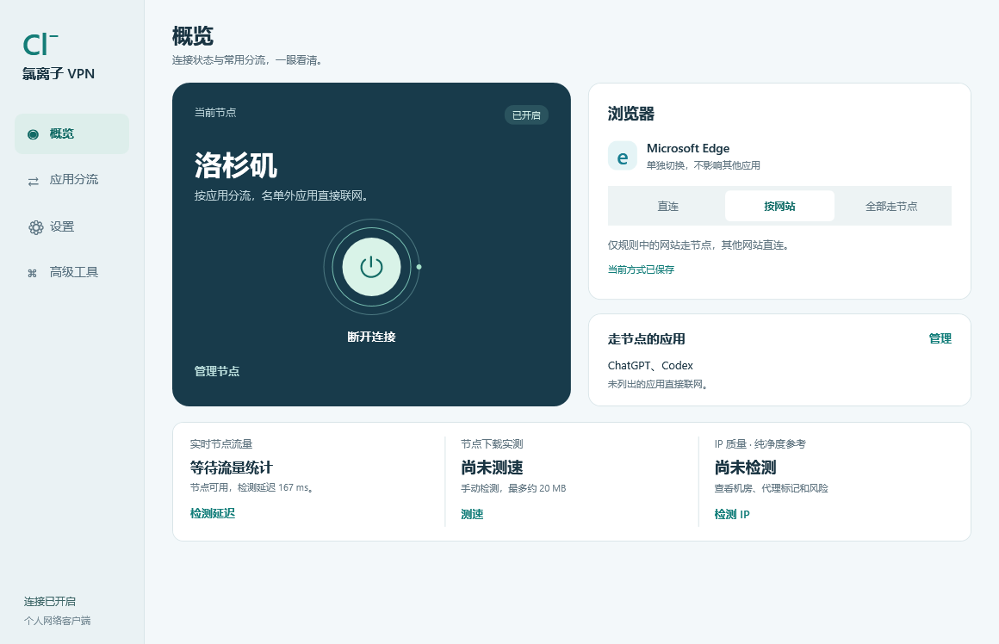

# 氯离子 VPN · Chloride VPN

基于 [2dust/v2rayN](https://github.com/2dust/v2rayN) 的 Windows 桌面定制客户端，聚焦清楚的连接状态、Edge 独立切换和应用分流。

**当前为 0.1.0-alpha.1 私有预览。** 此项目不提供节点、订阅或 VPN 服务；使用者需要自行配置可信节点。公开发布和二进制分发前仍需完成验收。



*上图是带示例数据的布局预览；首次运行没有节点，也不会预选图中的应用。*

## 功能

- 概览：连接总开关、节点、实时代理流量、手动下载测速和 IP 质量参考。
- Edge：直连、按网站、全部公网走节点三种方式，保存后应用。
- 应用分流：由使用者选择需要代理的程序，名单外应用默认直连；局域网优先直连。
- 连接控制：单实例守护、重复打开唤出原窗口、保存关闭状态并阻止后台重载重新连接。
- 设置与高级工具：节点导入、订阅、自启动及上游完整配置/日志入口。

## 首次使用

1. 在受支持的 Windows x64 环境构建，并准备经核验的兼容核心与规则数据。
2. 启动程序；需要正常的 Windows 管理员确认，不要求关闭系统保护。
3. 在设置或高级工具导入自己的节点，选择应用和 Edge 方式。
4. 主动点击“开启连接”。关闭总开关会停止本客户端传输；关闭窗口通常只是隐藏到托盘。
5. 若开启登录自启动，程序会后台启动并保留连接开关状态。它不是自动强制连接选项。

默认没有节点、没有私人应用名单，不自动创建登录任务，也不接管网络。手动打开使用 `--show`；登录任务使用 `--background`。

## 构建与开发

需要 .NET SDK 10.0.402、Git 子模块及 NuGet 访问权限。见 [构建与检查](docs/BUILD.md)。

```powershell
git clone --recurse-submodules https://github.com/91275979/chloride-vpn.git
cd chloride-vpn
pwsh -File scripts/Build.ps1
pwsh -File scripts/Test.ps1
```

构建结果在 `artifacts/win-x64`，当前只包含应用及继承的辅助工具，不包含运行核心、个人配置或签名安装器。已归档上游自动发布工作流；本仓库的 Windows 工作流只构建和检查，不会自动发布。

## 检测数据与限制

下载测速为一次有数据/时间上限的节点下载样本，不代表所有网站的速度。IP 质量目前使用 IPQuery，显示原始风险分、网络类型和 VPN/代理/Tor 标记、来源与时间；缺失字段保持未知。低风险或未标记不等于住宅 IP、无泄漏或任何平台一定接受。

Windows 全新环境、真实重启登录、完整界面开关循环、DNS/IPv6 与长期稳定性仍需验收。见 [已知问题](docs/KNOWN-ISSUES.md)、[安全与隐私](SECURITY.md) 和 [发布清单](docs/RELEASE-CHECKLIST.md)。不要上传节点链接、订阅、密钥、数据库或未脱敏日志。

## 上游与许可证

本项目基于 v2rayN **7.25.6**，基线提交 `1883178b5f1e222b6c6db2782e7a3d989b7cc18f`，保留上游源码历史、版权和 GPL version 3 许可证。定制版本不是上游官方发布。

详见 [LICENSE](LICENSE)、[修改及归属说明](NOTICE.md)、[上游 README](docs/UPSTREAM-README.md)。依赖、运行核心与数据文件各自的许可证仍需遵守。
